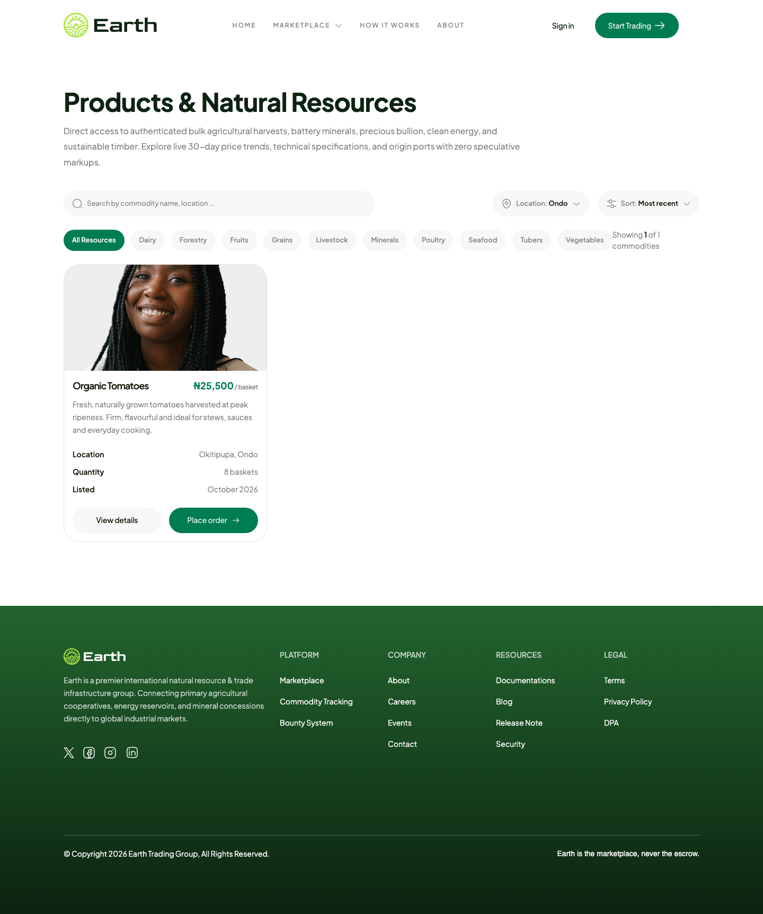
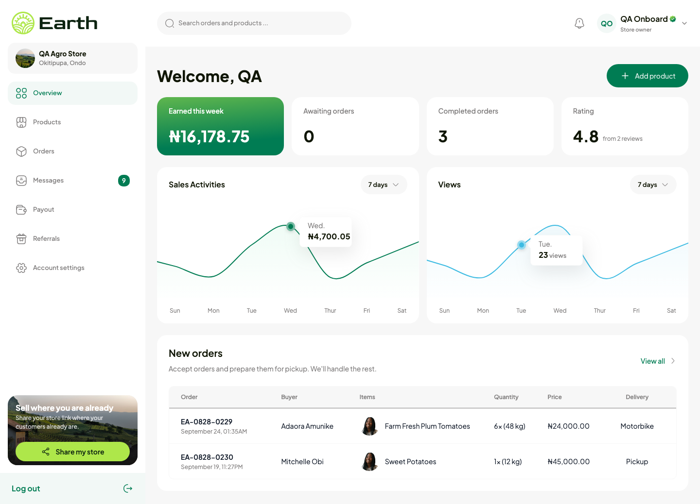
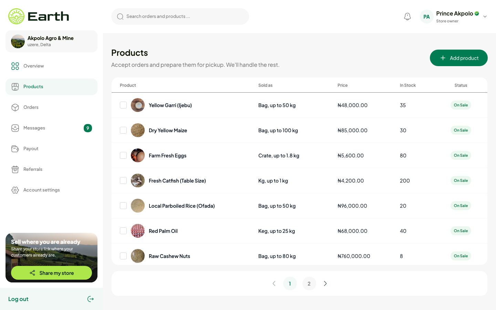
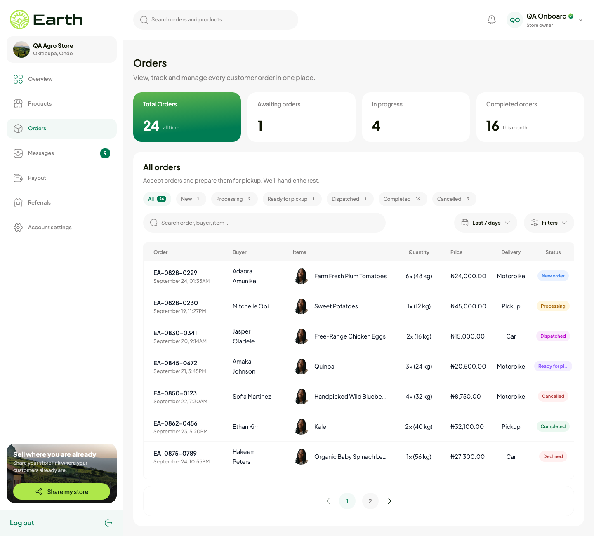
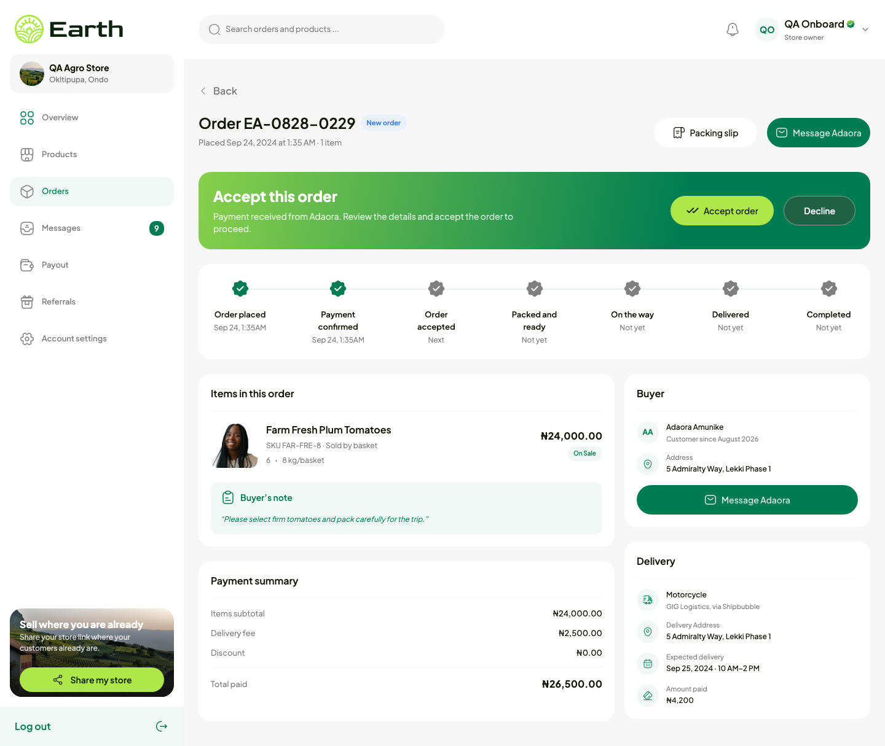
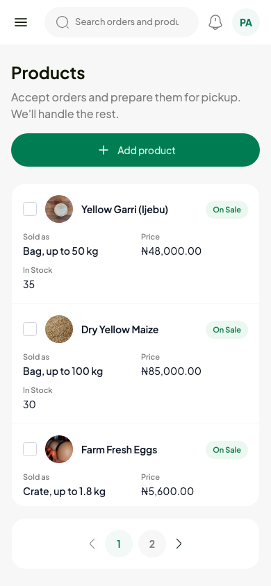

<div align="center">

# Earth

**Anything that grows from, is locked under, or feeds from the earth, sold directly by the people who produce it.**

A Nigeria-first marketplace for farm produce and raw commodities, with the same experience for a buyer in Lagos or in Houston.

[](https://react.dev)
[](https://www.typescriptlang.org)
[](https://vite.dev)
[](https://tailwindcss.com)
[](https://redux-toolkit.js.org)
[](https://earthapp.vercel.app)

[Live app](https://earthapp.vercel.app) · [Repository](https://github.com/praxxis-consult/earthapp) · [Report an issue](https://github.com/praxxis-consult/earthapp/issues)

</div>

---

## Table of contents

1. [About the project](#about-the-project)
2. [Screenshots](#screenshots)
3. [How Earth makes money](#how-earth-makes-money)
4. [Markets](#markets)
5. [Features](#features)
6. [Roadmap](#roadmap)
7. [Built with](#built-with)
8. [Getting started](#getting-started)
9. [Configuration](#configuration)
10. [Usage](#usage)
11. [Project structure](#project-structure)
12. [API integration](#api-integration)
13. [Known gaps](#known-gaps)
14. [Sample data](#sample-data)
15. [Design and responsive rules](#design-and-responsive-rules)
16. [Shared components](#shared-components)
17. [Testing and verification](#testing-and-verification)
18. [How we work](#how-we-work)
19. [Deployment](#deployment)
20. [Contributing](#contributing)
21. [Team](#team)
22. [License](#license)

---

## About the project

Earth connects primary producers (farms, cooperatives, fisheries, mines) with the buyers who want their goods, without a chain of middlemen in between. A tomato farmer in Ondo, a cocoa cooperative in Ogun and a gold-mine owner can all open a store on Earth; a restaurant in Lagos or an importer in the United States can buy from them the same way.

**What Earth is.** A marketplace. The seller lists, the buyer orders and pays the seller, and Earth takes a percentage. Earth is the marketplace, never the escrow: it does not hold the buyer's money, and it is not a logistics company. For delivery Earth is an aggregator: it integrates logistics providers backend to backend, the buyer picks one at checkout, or collects from the store.

**What this repository is.** The Earth web app, in three parts:

| Part | What it holds |
| --- | --- |
| Public site | Landing page (hero, what we deal in, markets, trust section, catalogue preview, waitlist), About, the marketplace (listings by region, product page, order page) |
| Seller onboarding | Create an account, confirm it by email code, sign in, then set up the store in four steps and go live |
| Seller dashboard | Overview, products, orders, messages, payouts, referrals, account settings |

Every screen is built from the design file's frames and measured against them to the pixel. Where the Earth API has an endpoint, the screen runs on it; where it does not yet, the screen shows its real zero state and never an invented figure.

## Screenshots

| Landing page | Marketplace |
| --- | --- |
|  |  |

| Dashboard overview | Products |
| --- | --- |
|  |  |

| Orders | Order detail |
| --- | --- |
|  |  |

<p align="center"></p>

The overview, orders and order-detail captures use the sample rows described under [Sample data](#sample-data); the products captures show a real store on the QA API.

## How Earth makes money

- **Commission on stores.** When a buyer pays and confirms receipt, Earth takes a percentage of the order. The buyer pays the seller; Earth never holds the money.
- **Commission on logistics.** Delivery is by the logistics companies Earth integrates. The buyer chooses one at checkout, and Earth earns on that choice.

Nothing else is charged to sellers or buyers.

## Markets

The marketplace is organised by what comes from the earth. The categories the API serves today:

| | | |
| --- | --- | --- |
| Fruits | Vegetables | Tubers |
| Grains | Livestock | Poultry |
| Seafood | Dairy | Forestry |
| Minerals | | |

A store selects the categories it sells in during onboarding, and every listing belongs to one of them.

## Features

**For buyers**
- Browse live listings by state, search, and filter by category
- Product page with gallery, price per unit, availability, minimum order, key facts, shipping terms and reviews
- Place-order flow with pickup and delivery options (submission waits on the orders endpoint)
- Join the launch waitlist from the landing page and see your place in your city

**For sellers**
- Sign up with an email code, no password
- Four-step onboarding: store and categories, location, identity and selfie, bank account, then go live
- Add products with up to six photos, price and selling unit, stock, pickup details and a publishing checklist; save as draft or publish; edit later
- Products list that fits the screen and scrolls inside its card, with the pager always visible; cards on phones
- Orders with status tabs, search and date range; order detail with accept, decline, ready, dispatch and complete actions, a seven-step timeline, packing slip, track-delivery and receipt views
- Messages with buyers: text, a listing, a photo or video, paid invoices and receipts
- Payouts with paid and pending totals, the order-limit tiers and transactions
- Referral link and sign-ups
- Account settings for store details, personal details, payout account and notifications
- Share-your-store link from the sidebar

**Across the app**
- Session restore on reload, one-time-code sign in, automatic token refresh
- Phone, tablet and desktop layouts, derived from the desktop designs
- Honest zero states on every page whose endpoint does not exist yet, with a development switch to view sample rows

## Roadmap

| Phase | Scope | Status |
| --- | --- | --- |
| Waitlist | Landing page with the launch waitlist, city places and referral links | Live |
| Stores, one city | Seller onboarding, products with photos, the marketplace, orders with pickup and same-city delivery through integrated logistics providers, payouts | Front end built; orders, messages, payouts and the overview wait on their endpoints (see [Known gaps](#known-gaps)) |
| Verified profiles and requests | Verified seller profiles and screened buyer requests for high-value goods such as gold | Planned |
| Bulk lane | Larger consignments between regions | Planned |

## Built with

| Concern | Choice |
| --- | --- |
| UI | [React 19](https://react.dev), TypeScript, [Vite 8](https://vite.dev) |
| Styling | [Tailwind CSS v4](https://tailwindcss.com), design tokens in `src/index.css` |
| State and data | [Redux Toolkit](https://redux-toolkit.js.org) with RTK Query |
| Routing | [React Router v7](https://reactrouter.com) |
| Lint and tests | [oxlint](https://oxc.rs), [Vitest](https://vitest.dev) with Testing Library |
| Hosting | [Vercel](https://vercel.com): static build plus a `/v1` rewrite to the API |
| Fonts | Plus Jakarta Sans for the product, Goldman for the wordmark |

## Getting started

### Prerequisites

- Node.js 20 or newer
- npm (comes with Node)

### Installation

```bash
git clone https://github.com/praxxis-consult/earthapp.git
cd earthapp
npm install
```

### Running

```bash
npm run dev
```

Open the URL Vite prints (http://localhost:5173 by default; add `-- --port 5179` to use another port). No environment file is needed: the dev server proxies `/v1` to the QA API.

### Scripts

| Script | What it does |
| --- | --- |
| `npm run dev` | Start the dev server with hot reload |
| `npm run build` | Production build into `dist/` |
| `npm run preview` | Serve the production build locally |
| `npm run lint` | Run oxlint |
| `npm run test` | Run the Vitest suite once |
| `npm run test:watch` | Run Vitest in watch mode |
| `npx tsc --noEmit` | Typecheck the app and its tests (Vite builds without it, so this is the only type gate) |

## Configuration

| Variable | Where | Meaning |
| --- | --- | --- |
| `EARTH_API_TARGET` | shell, before `npm run dev` | The API origin the dev proxy forwards `/v1` to (no path). Defaults to `https://earthapi.loodit.com`, the same origin `vercel.json` rewrites to |
| `EARTH_REALTIME_TARGET` | shell, before `npm run dev` | The realtime service (Socket.IO) the dev proxy forwards `/socket.io` to. Defaults to the API target, which serves it on the same origin |
| `VITE_REALTIME_URL` | build environment (Vercel) | Overrides where a production build opens the socket. Unset, it connects to the API origin directly (the browser speaks CORS and WSS to it, so its CORS list must name the site) |
| `/v1` rewrite | `vercel.json` | Where production forwards `/v1`. Change it to point a deployment at another API |

There are no secrets anywhere in this repo or its deployment: the app never holds an API key (the bank lookup's Paystack key lives on the Earth API), and the refresh token is an HttpOnly cookie the browser manages.

## Usage

### Walk the whole app on the QA API

1. Open the landing page and click **Start Trading**.
2. Sign up with any email. On the QA API the one-time code `000000` is accepted for every account, so no inbox is needed.
3. Confirm the account, then sign in with the same code.
4. Complete the four onboarding steps and go live. The dashboard opens with your real store.
5. Add a product with a photo, publish it, and find it on the marketplace under your state.

### Routes

| Route | Page |
| --- | --- |
| `/` | Landing page |
| `/about` | About |
| `/marketplace` | Marketplace listings for one state (picker; Ondo by default) |
| `/marketplace/:id` | Product page |
| `/marketplace/:id/order` | Place order |
| `/signup`, `/signup/verify` | Sign up, confirmation code |
| `/onboarding/store`, `/location`, `/verify-id`, `/bank`, `/review` | The onboarding steps |
| `/dashboard` | Overview |
| `/dashboard/products`, `/add`, `/:id`, `/:id/edit` | Products list, add, detail, edit |
| `/dashboard/orders`, `/:id` | Orders list, order detail |
| `/dashboard/messages` | Messages |
| `/dashboard/payout` | Payouts |
| `/dashboard/referrals` | Referrals |
| `/dashboard/settings` | Account settings |

Sign-in is a modal from the navbar, not a route. Dashboard routes are guarded: an anonymous visitor is sent to the landing page with the sign-in modal open and returned to the page they wanted after signing in.

## Project structure

```
src/
  main.tsx, App.tsx     entry: Redux Provider, SessionBootstrap, router
  app/                  store.ts, hooks.ts, api/apiSlice.ts (base query), api/problem.ts (error types)
  feature/              one folder per API area: slices, RTK Query endpoints, hooks
    authentication/     authSlice (persisted session), authApiSlice, useAuth, RequireAuth, SessionBootstrap
    stores/             storesApiSlice (onboarding, categories), useStore
    products/           productsApiSlice
    uploads/            uploadsApiSlice
    marketplace/        catalogApiSlice (public catalogue)
    waitlist/           waitlistApiSlice
    ui/                 uiSlice
  services/earthApi.ts  shared API types and thin wrappers for code outside React
  onboarding/           the onboarding draft kept between steps
  data/                 per-page data modules (zero state) and their .sample twins; sample.ts is the switch
  lib/                  catalog.ts (public listing mapping, regions), productView.ts, reviews.ts
  pages/
    Home/               Hero, WhatWeDeal, EarthMarkets, TrustSection, MarketplaceCatalog, Newsletter
    About/, NotFound/
    Marketplace/        index (list), ProductDetail, PlaceOrder
    Auth/               Signup, SignupOtp
    Onboarding/         StoreName, Location, VerifyId, BankDetails, ReviewDetails
    Dashboard/          index (overview), Products, AddProduct, ProductDetail, Orders, OrderDetail,
                        Messages, Payout, Referral, Settings, orderColumns (shared table columns)
  components/
    layout/             Navbar, Footer, MainLayout, AuthLayout, OnboardingLayout, OnboardingHeader,
                        DashboardLayout, DashboardSidebar, DashboardTopbar
    ui/                 shared pieces, modals and dialogs
  routes/               React Router v7 route table
  assets/               icons and images exported from the design file
  utils/styles.ts       font helper, CTA gradients, SCROLL_ROW
  test/                 Vitest component tests
figma-refs/             raw design dumps and reference renders used for measuring (not shipped)
scripts/                working notes for the frame-to-component process
vercel.json             /v1 rewrite, SPA fallback, security headers
vite.config.js          dev proxy for /v1 and /socket.io
```

## API integration

**One origin.** The browser only ever calls its own origin under `/v1`. In development `vite.config.js` proxies that to the API and strips the `Origin` and `Referer` headers; in production `vercel.json` rewrites it. The prefix stays `/v1` because the refresh cookie the API sets is scoped to `Path=/v1/auth`.

**Sessions.** Signing in returns an access token with its expiry and sets an HttpOnly refresh cookie. The token is kept in the Redux `auth` slice and local storage. The base query in `src/app/api/apiSlice.ts` adds the bearer header, refreshes the token just before it expires or once after a 401, and converts problem+json responses into typed errors (with `retryAfter` when the API sends one). All refreshes go through one single-flight helper, because the API rotates the refresh cookie on every call and two refreshes in flight would end the session.

**On load.** `SessionBootstrap` restores the session from the stored token, or from the cookie alone by refreshing, then reads `/accounts/me`. Anything else leaves the visitor anonymous.

**Live updates.** Once the account is confirmed, `src/feature/realtime/Realtime.tsx` opens one Socket.IO connection to the realtime service with the access token in the handshake (`src/feature/realtime/realtimeClient.ts`). The service sends identifiers only; every durable event is acknowledged and marks the matching queries stale (chats, notifications, orders, overview), so the pages read again over HTTP, which stays the saved record. Events are applied once per id and stale versions are dropped. `sync.required` refreshes everything and resubscribes the open thread; the open thread (`useConversationLive`) asks for messages after its last sequence when one is announced and shows the other side's typing. While the socket is up the pages stop polling; without it (an origin the API's CORS list does not name, such as a preview deployment; service down; reconnection exhausted) they poll as before. A socket the server closed is reopened after the session is checked, with a jittered wait and at most five times.

**Endpoints by area**

| Area (`src/feature/`) | Endpoints |
| --- | --- |
| authentication | `POST /accounts`, `POST /auth/otp/request`, `POST /auth/otp/resend`, `POST /auth/otp/verify` (intent `ACCOUNT_CONFIRMATION` or `LOGIN`), `GET /accounts/me`, `POST /auth/refresh`, `POST /auth/logout` |
| stores | `GET /stores/me/onboarding`, `POST /stores/me/onboarding` (draft or live, with `expectedVersion`), `GET /store-categories?page&limit` |
| banks | `GET /banks?country` (501 where the API has no lookup for that country), `GET /banks/resolve?country&bankCode&bankName&accountNumber` (signed in; answers `matchesIdentity`, the API's own comparison with the holder's name) |
| products | `POST /products` (create and update, with `expectedVersion`; `price` in kobo), `GET /products/me?page&limit&status`, `GET /products/{id}`, `DELETE /products/{id}`, `GET /products/{id}/reviews`, `POST /products/{id}/views` |
| uploads | `POST /uploads` (multipart `file` and `purpose`: `SELFIE`, `PRODUCT_IMAGE`, or `CHAT_MEDIA` with `conversationId`) |
| chats | `GET /chats`, `GET /chats/{id}/messages` (and `?afterSequence=` to catch up), `POST /chats/{id}/messages` (TEXT, PRODUCT, MEDIA with a `clientMessageId`), `POST /chats/{id}/read`, `POST /chats` (Message seller) |
| delivery | `GET`/`PUT /delivery/stores/{storeId}/shipping` (the seller's pickup contact and parcel, in store settings), `POST /delivery/quotes` (the checkout's first step) |
| notifications | `GET /notifications`, `GET /notifications/unread-count`, `POST /notifications/{id}/read` |
| accounts | `PATCH /accounts/me`, `DELETE /accounts/me`, `GET`/`PATCH /accounts/me/notification-preferences` |
| overview | `GET /stores/me/overview` (LIVE stores; 503 while the API prepares it) |
| marketplace | `GET /products?page&limit` (every published listing; `country`, then `region`, narrow it), `GET /stores/{id}` per listing's store, `GET /stores/{id}/products?page&limit` (one store), `GET /products/{id}` |
| waitlist | `POST /waitlist/entries` (with an `Idempotency-Key`), `POST /waitlist/verification`, `POST /waitlist/verification/claim`, `GET /waitlist/me` (with `x-place-token`) |

**Rules the API enforces that the UI respects**: every amount is an integer string in kobo (the form takes naira and converts at the edge, `src/lib/productView.ts`); a store goes LIVE only with the bank's code from the name lookup; every list pages by number (`page`, `limit`; the answer carries `hasNext` and `nextPage`) and the app reads lists to the end; country codes are ISO-2 upper case; a product's category must be one the store selected; a LIVE onboarding save must send the whole profile back; `expectedVersion` must match or the save is refused with a version-conflict message.

**What runs on the API today**

| Screen | Status |
| --- | --- |
| Sign up, confirmation, sign in, session restore, log out | Live |
| Seller onboarding, all four steps and go live | Live |
| Products: list, add with photo uploads, edit, publish or draft, detail, delete | Live |
| Account settings: store details, personal details, payout account, notification choices, cover photo | Live (description, opening hours and the cover photo are kept in the browser until the API has fields for them) |
| Marketplace list, product page, order page | Live catalogue: every store, a country or a region. Message seller opens the chat (sign-in first). Place order takes the delivery address and asks the carriers for quotes (`POST /delivery/quotes`); choosing a quote and paying wait for the API to document the quote and order answers, and the QA server's carriers do not answer yet |
| Waitlist on the landing page | Live |
| Dashboard shell: store name and area, seller name, share-store link | Live |
| Messages: threads, text, product and photo messages, read position, unread badge, typing | Live (socket when the realtime service is reachable, polled otherwise) |
| Overview numbers and charts | Live from the API for a LIVE store (zeros until the API has counted activity) |
| Orders, payouts, referrals | Zero state (payouts and referrals endpoints exist but their answers are undocumented) |
| Referrals | Local placeholder |
| Reviews on the product page | Live: read from the API; writing waits for a completed order to review from |

Each zero-state page reads one data module under `src/data/` shaped like the response it expects, so wiring the endpoint later changes that module and nothing else on the page.

## Known gaps

Checked against the API's `/v1/docs-json`, which lists 24 paths today. These are the endpoints the app is waiting for, in dashboard order.

1. **Overview**: one endpoint returning earnings this week, awaiting and completed counts, rating with review count, sales per day and views per day for the last seven days, and the latest orders.
2. **Products and settings**: `DELETE /products/{id}`; a seller-set SKU on create (the design has an editable SKU, the API generates it); `PATCH` and `DELETE` on `/accounts/me`; store description and opening hours on the onboarding profile; notification preferences; a decision on the category limit (the API accepts seven per store, the sign-up design says up to three).
3. **Orders**: list and detail, plus the transitions the detail page already has dialogs for: accept, decline with a reason, ready for pickup with packing photos, dispatched with courier and tracking, completed, cancelled. Statuses the app knows: new, processing, ready, dispatched, completed, cancelled, declined.
4. **Messages**: threads with unread counts; messages of kind text, product, media and invoice; send; mark read; the realtime service announces new messages, reads and typing.
5. **Payouts and referrals**: paid total, pending, the order limit and tiers, transactions; referral code and link, counts and the list of referred users.
6. **Reviews**: read and write per product, and a store rating.
7. **Marketplace and buyers**: a cross-store product listing (today the catalogue reads every store's products one store at a time), placing an order from the buyer side and payment confirmation.
8. **Smaller**: confirmation does not sign the user in (a second LOGIN code is needed); the waitlist's dev code is off on the QA server; `otp/verify` rate-limits an address after a few sign-ins.

## Sample data

The zero-state pages can be viewed with sample rows while developing, so their populated layouts (tables, status badges, payout rows) can be checked against the frames.

- **Switch on**: open any dashboard URL with `?sample=1`, for example `http://localhost:5173/dashboard/orders?sample=1`. The samples stay on while you click around in that tab.
- **Switch off**: open any dashboard URL with `?sample=0`. Closing the tab also switches it off, because the choice is kept in the tab's session only.
- **Production** never includes the samples: the switch is compiled out and the sample modules are not bundled.

The samples live beside their data modules (`src/data/orders.sample.ts`, `payouts.sample.ts`, `referrals.sample.ts`) and are selected by `src/data/sample.ts`. They cover every order status the pages know, which is how the order-detail flows are exercised locally.

## Design and responsive rules

**Desktop is the source of truth.** Every screen is built from the design file's frame at 1440 and measured against it in a headless browser; element positions are checked to within a pixel before a screen is called done. Icons and illustrations are the file's own exports, copy is the file's copy, and gradients are solved from the frame's gradient handles (the colour bands run parallel to the width handle, so a start-to-end angle is wrong on wide cards).

**Mobile is derived.** The file has no mobile frames, so phone and tablet layouts are derived from the desktop frames under one rule that keeps desktop safe:

- Desktop classes stay exactly as measured.
- Phone and tablet are added with `max-lg:` (below 1024), `max-md:` (below 768) and `max-sm:` (below 640) overrides, or `lg:hidden` / `max-lg:hidden` swaps. Never by changing a desktop value.
- Breakpoints: 1024 and up is desktop (the 1200px container gets gutters down to 1024); 768 to 1023 is tablet; below 768 is phone with 16px gutters, no horizontal page scroll and touch targets of at least 44px.

**Lists that fit the screen.** The products list fills the viewport on every width, scrolls inside its card with the header in place, and keeps the pager visible. The orders panel does the same on desktop; on phones it flows, because the stat cards, tabs and search leave no room for a fitted list there.

**Deviations are written down.** Where a frame could not be followed (an inset on one side only, a figure the API cannot supply, a control the API cannot serve), the code comment at that spot says what the frame has and why the code differs.

## Shared components

| Component | Where | Role |
| --- | --- | --- |
| `Drawer` | `components/ui/Drawer.tsx` | Collapsed navigation below `lg`: backdrop plus slide-in panel, Escape and backdrop close it, page scroll locked. Used by the public navbar and the dashboard sidebar |
| `DataTable` | `components/ui/DataTable.tsx` | One column list renders the design's table from `md` up and one card per row below; `scroll` mode keeps the header in place while rows scroll inside the card. Used by products, orders, payouts, referrals and the overview |
| `orderColumns` | `pages/Dashboard/orderColumns.tsx` | The order table's columns, shared by the orders page and the overview |
| `StatCard` | `components/ui/StatCard.tsx` | The 120px stat card with the solved lime-to-green gradient on the first card. Used by the overview and orders |
| `EmptyBlock` | `components/ui/EmptyBlock.tsx` | The "nothing here yet" illustration, title and copy, with an optional action. Used by every zero state |
| `LineChart` | `components/ui/LineChart.tsx` | The overview's sales and views charts, drawn from one value per day: smooth line, the frame's fade beneath, the tooltip pinned to the active day and moved by the pointer |
| `Pager` | `components/ui/Pager.tsx` | The pagination bar: first three pages, neighbours of the current page, the last page, with gaps |
| `SelectorMenu` | `components/ui/SelectorMenu.tsx` | The design's dropdown list and items, used by every select in sign-up, onboarding and the dashboard |
| Modals and dialogs | `components/ui/` | `SuccessModal`, `AuthModal`, `OrderStatusDialog`, `TrackDeliveryModal`, `ReceiptModal`, `SettingsDialogs`, each built from its frame |
| `SCROLL_ROW` | `utils/styles.ts` | A chip or tab row that scrolls sideways on phones instead of wrapping |

Rule of thumb: when the same wrapper or block appears three times, it becomes a shared component.

## Testing and verification

**Automated.** `npm run test` runs the Vitest component tests in `src/test/` (navbar, footer, markets section, button). `npm run lint` runs oxlint. `npx tsc --noEmit` typechecks.

**Against the frames.** Each screen is measured in headless Chrome against the frame's coordinates before it is called done, at the frame's own size. The responsive layer is audited at 390, 768 and 1024: no element may extend past the viewport (chips inside intentional scroll rows and images inside clipped containers are the only accepted exceptions), and desktop screenshots are compared with a baseline taken before the change.

**Against the API.** The full flows are run end to end on the QA API: sign up, confirm, sign in, onboarding to a live store; add a product with a photo upload, publish, edit. A page is not called integrated until the request is seen leaving and the response is seen on the page.

**Before a pull request.** Lint, typecheck and build clean; measurements and audits in the PR description; every deliberate deviation listed.

## How we work

The project runs as a loop of five departments. Each acts on its own, produces its own output and hands to the next. No department skips a step because another one "probably" covered it, and the loop only ends when the Judge awards full marks.

| Department | What it does | What it hands over |
| --- | --- | --- |
| **Builder** | Implements the screen from the frame: raw frame data, the file's own assets, exact copy, measured positions at 1440, the responsive layer, wiring to the API or the honest zero state. | The code, its measurements against the frame, and a note of every deliberate deviation. |
| **Adversarial auditor** | Attacks the work: overflow at 390, 768 and 1024; wrong or invented data on a page; controls that do nothing; broken sign-in, refresh and session paths; races and rate limits; anything a hostile buyer or seller could exploit. | A findings list, each with a concrete failure scenario and where it is. |
| **Fixer** | Fixes every finding, each with a regression test or a scripted check that fails before the fix and passes after. | The fixes and their tests. |
| **Design researcher** | Goes outside the project: studies the best real marketplace and seller-dashboard UIs and raises this frontend to that standard wherever the design file is silent (mobile layouts, empty states, loading, motion, micro-copy). | Concrete proposals with references, applied where they do not contradict the frames. |
| **Judge** | Grades the current state against the rubric below and says exactly where points are lost. | A scored report; anything short of full marks goes back to the Builder or the Fixer. |

### The rubric the Judge grades against

1. **Frame fidelity**: every measured element within 1px of the frame at 1440; gradients, assets and copy from the file; deviations written down.
2. **Responsive**: no element past the viewport at 390, 768 and 1024; touch targets at least 44px; lists usable on a phone; desktop unchanged against the baseline.
3. **Data honesty**: every number on a page comes from the API or is a real zero; sample rows only behind the switch; nothing invented.
4. **Integration**: every control on a page does what it says, or is clearly marked inert with the reason; the full flows pass end to end against the QA API.
5. **Code health**: lint, typecheck and build clean; shared pieces used instead of copies; the conventions in `CLAUDE.md` followed.
6. **Accessibility basics**: labelled inputs, keyboard-reachable rows and dialogs, dialogs closable with Escape, images with alt text or marked decorative.

## Deployment

- Vercel builds production from `main` and a preview for every branch and pull request.
- `vercel.json` carries the `/v1` rewrite to the API, the SPA fallback and the security headers (`X-Content-Type-Options`, `Referrer-Policy`, `X-Frame-Options`).
- A page that waits on an endpoint ships with its zero state and its sample module; a pull request is not held for the endpoint.

## Contributing

1. Branch from `main` (`feature/<what-it-does>`).
2. Build to the frame and measure; keep desktop classes untouched when adding the responsive layer.
3. Run `npm run lint`, `npx tsc --noEmit` and `npm run build` before pushing.
4. Open a pull request into `main` with the measurements, the audits at 390, 768 and 1024, and every deliberate deviation listed.
5. Commit messages say what changed and why in plain words. They describe the product, not the tools used to make it.

The conventions the code follows (tokens, folders, icon imports, state management, lint) are in `CLAUDE.md`.

## Team

| Role | |
| --- | --- |
| Frontend | Prince Akpolo, Uchechukwu Ekezie |
| Backend and API | Ralph |
| Design | Seleem |
| Company | Praxxis Consult |

## License

Private and proprietary. Copyright Praxxis Consult. Not licensed for reuse or redistribution.
